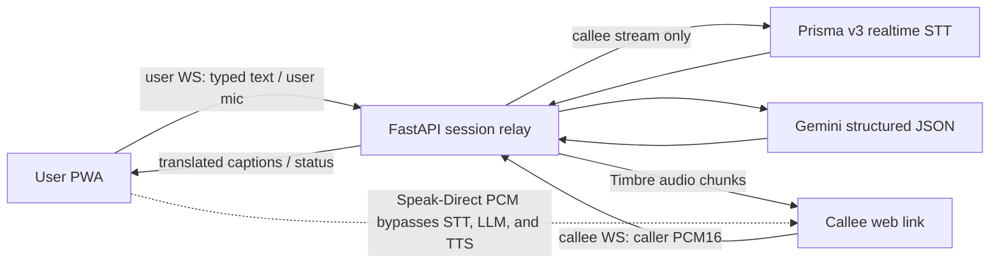

# Awaaz Setu

Awaaz Setu is a prototype voice relay for accessible calls across India's 10 Gnani-supported languages. It combines live captions, cross-language translation, tone-controlled spoken replies, and three reply modes: **Type / Tap**, **Speak-Direct**, and **Speak & Transform**.

The caller joins from a web link; this prototype does not place or inject audio into a native cellular call. **Gate Mode is a clearly scripted delivery demo** and does not contact a real courier. Awaaz Setu is not a medical, emergency, legal, or financial service. Calls are not recorded. Transcript and summary history is off by default and saved only after an explicit opt-in.

## Run locally on Windows

Requirements: Python 3.11+, Node.js 20+, and PowerShell.

```powershell
Copy-Item .env.example .env
.\tasks.ps1 setup
.\tasks.ps1 test
npm --prefix frontend test
npm run build
```

Keep `MOCK_MODE=true` for an offline demo. For live use, set `MOCK_MODE=false` and configure `GNANI_API_KEY` and `GEMINI_API_KEY` in `.env`. Optional Supabase auth requires `SUPABASE_URL` and `SUPABASE_ANON_KEY`; apply [the RLS migration](supabase/migrations/001_init.sql). Blank Supabase settings leave local guest mode available.

Start two PowerShell terminals from the repository root:

```powershell
.\tasks.ps1 api
```

```powershell
.\tasks.ps1 frontend
```

Open `http://localhost:5173`. Create a call and open its join link in a second browser/device, or use **Gate Mode (Scripted Demo)** for a simulated delivery interaction.

## Architecture



The user and callee have isolated WebSocket channels. Caller microphone frames go only to Prisma; user microphone frames go over the authenticated user channel and either directly to the callee player or to the separate user-side Prisma transform stream. No call audio is persisted. See [docs/ARCHITECTURE.md](docs/ARCHITECTURE.md) for routing, reconnects, and deployment boundaries.

## Evaluation and evidence

- [Evaluation results](docs/RESULTS.md): regenerated by `.\tasks.ps1 eval --mock` or by an explicit live run.
- [Gnani smoke findings](docs/gnani/FINDINGS.md): owner-reported M0 results and their evidence gaps.

Mock measurements validate local plumbing and entity extraction only; they are not provider latency, translation quality, or ASR accuracy. Live evaluation uses synthetic Timbre speech and costs API quota. No human microphone or carrier-call audio is included by default.

## Prototype limits

- The demo scene is simulated, not a real incoming delivery call.
- The web-link call is a browser VoIP-style relay. Native cellular call audio injection is not implemented.
- Provider behavior, costs, and latency depend on account limits and have to be measured by the operator.
- Speech recognition and translation can be wrong. Confirm numbers, names, dates, and other important details with the caller.
